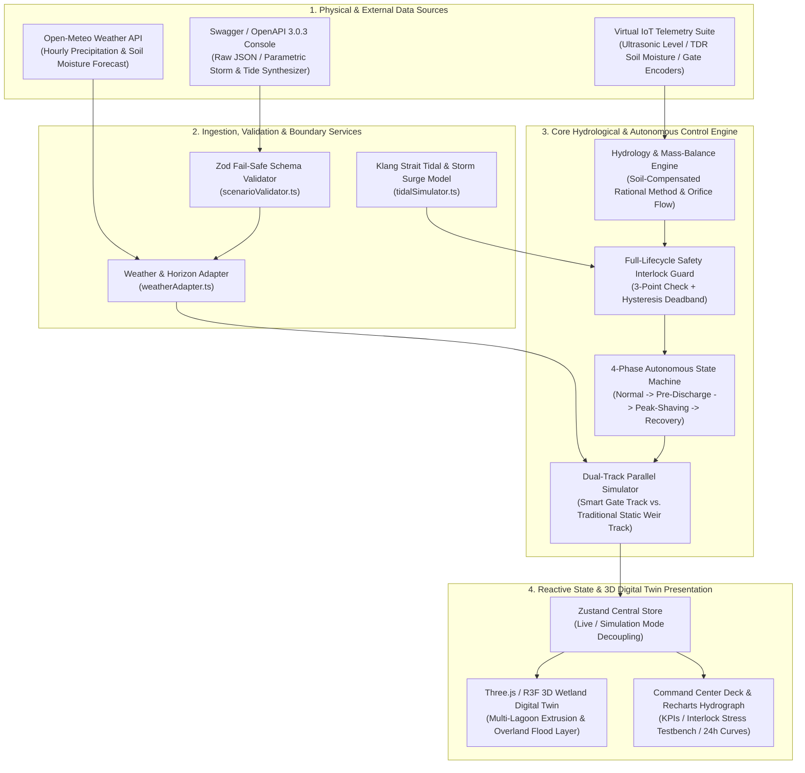

# AI-Driven Hydrological Intelligence & Predictive Wetland Balancing System

> **Bandar Bukit Raja (BBR) 125-Acre Smart Flood Mitigation & Digital Twin Command Center**  
> Transforming physical retention wetlands from passive static ponds into an autonomous, predictive **Cyber-Physical Sponge Infrastructure (CPS)** that prevents local flash floods without overwhelming downstream tidal river basins.


---

## 1. Executive Overview

Located in Klang, Selangor, Malaysia (`3.085°N, 101.445°E`), the **125-acre ($505,857\text{ m}^2$) Bandar Bukit Raja (BBR) Townpark Wetland** serves a **$500\text{ ha}$ ($5,000,000\text{ m}^2$)** urban catchment. The basin faces two compounding hydro-meteorological challenges:
1. **Tropical Convective Cloudbursts**: High-intensity monsoon storms ($80\text{–}160\text{ mm/h}$) generate rapid surface runoff that can overwhelm static retention ponds within minutes.
2. **Downstream Klang Strait Tidal Backwater**: Semidiurnal high tides ($M_2$ cycle) and storm surges periodically raise downstream water levels above $2.50\text{ m}$. Blindly opening sluice gates during high tide causes reverse saltwater/floodwater backflow or compounds downstream urban flooding.

This platform implements a **predictive, closed-loop hydrological control system** paired with a **real-time 3D WebGL Digital Twin**:
- **Predictive Pre-Discharge**: Ingests 24-hour numerical weather forecasts (Open-Meteo API) to proactively lower the wetland water level from its $2.00\text{ m}$ normal operating baseline down to the $1.00\text{ m}$ ecological floor ahead of incoming storms—unlocking **$505,857\text{ m}^3$** of additional flood-retention buffer.
- **Peak-Shaving Detention**: Automatically closes motorized sluice gates during peak rainfall to detain upstream runoff inside the 125-acre sponge basin.
- **Full-Lifecycle Downstream Safety Interlock**: Continuously monitors hydraulic head differential ($\Delta H$) and downstream Klang River tidal elevation ($H_{\text{down}}$) with industrial hysteresis deadbands, executing sub-second emergency gate lockouts if downstream levels breach critical thresholds.

---

## 2. Key System Capabilities

### 2.1 3D WebGL Wetland Park Digital Twin (`Three.js` / `@react-three/fiber`)
- **Multi-Lagoon Hydro-Topography**: Procedural 6-basin interconnected organic wetland park with 3-tier terraced eco-shelves:
  - *Layer 1 ($Y = 1.52$)*: Inner pebble & mud shelf exposed at the $1.00\text{ m}$ ecological minimum datum.
  - *Layer 2 ($Y = 2.15$)*: Middle marsh terrace cradling the $2.00\text{ m}$ normal baseline pool.
  - *Layer 3 ($Y = 2.875$)*: Upper park meadow platform aligned flush with the $3.50\text{ m}$ critical spillover threshold.
- **Exact Normal-Offset $3.50\text{ m}$ Contour Rings**: 2D perpendicular inward-offset Bezier spline tubes ($360^\circ$ shoreline fit) highlighting the critical flood threshold across all six lagoons.
- **Dual-Phase Flood Inundation Physics**:
  - When $H \le 3.50\text{ m}$, water remains confined within the six sculpted lake basins.
  - When $H > 3.50\text{ m}$, a unified park-wide translucent red flood layer (`parkWideFloodGeometry`) rises seamlessly across the entire landmass together with the lakes.
- **Interactive Telemetry & Baseline Ghost Wireframe**: Animated dual-bay motorized sluice gates, IoT ultrasonic level gauge mast with threshold rings, upstream $Q_{\text{in}}$ cascade, and an optional orange wireframe overlay comparing the **Traditional Unmanaged Wetland Level** in real time.

### 2.2 Decoupled Dual-Mode Operation
- **Live Operation Mode (`LIVE`)**: Anchored to Malaysia Standard Time (`MYT / UTC+8`), synchronizing with Open-Meteo (`6h` hindcast + `24h` forecast) and real-time synthetic Klang Strait tidal curves. Includes an offline fail-safe baseline generator if external network connectivity is unavailable.
- **Custom Simulation Mode (`SIMULATION` / API Studio)**: Full timeline scrubber with proportional tick marks, variable playback speed (`10x`, `60x`, `150x`, `300x`), interactive storm/tidal parameter sliders, and an **OpenAPI 3.0.3 / Swagger Injection Console** with strict `Zod` schema validation.

### 2.3 Dual-Track Comparative Analytics
Every simulation run computes two isolated hydrological tracks side-by-side under identical rainfall and tidal forcing:
1. **Track A — AI Smart Sluice Gate System**: Governed by the 4-phase predictive state machine and downstream safety interlock.
2. **Track B — Traditional Unmanaged Baseline**: Static retention pond at $2.00\text{ m}$ equipped only with passive broad-crested overflow weirs.

---

## 3. Enterprise System Architecture



---

## 4. Hydrological & Hydraulic Governing Equations

All physical simulations and control decisions are governed by deterministic hydrological and hydraulic equations implemented in [`src/core/hydrologyEngine.ts`](src/core/hydrologyEngine.ts).

### 4.1 Soil-Saturation Sensitive Rational Method (Inflow $Q_{\text{in}}$)
To account for tropical soil saturation during prolonged monsoon events, the effective runoff coefficient $C_{\text{eff}}(t)$ scales dynamically with top-layer soil moisture saturation $S(t) \in [0, 1]$:

$$C_{\text{eff}}(t) = \min\Big(0.95,\; C_{\text{base}} + (1 - C_{\text{base}}) \cdot S(t) \cdot \gamma_{\text{soil}}\Big)$$

where $C_{\text{base}} = 0.65$ is the baseline urban-park runoff coefficient and $\gamma_{\text{soil}} = 0.30$ is the soil saturation sensitivity factor.

The catchment surface runoff inflow $Q_{\text{in}}(t)$ ($\text{m}^3/\text{s}$) is computed via the Rational Method:

$$Q_{\text{in}}(t) = \frac{C_{\text{eff}}(t) \cdot i(t) \cdot A_{\text{cat}}}{360}$$

where $i(t)$ is rainfall intensity ($\text{mm/h}$), $A_{\text{cat}} = 500\text{ ha}$, and $360$ is the metric unit conversion factor ($\frac{3600\text{ s/h}}{10\text{ m}^3/(\text{ha}\cdot\text{mm})}$).

### 4.2 Available Retention Buffer Volume ($V_{\text{avail}}$)
With a 125-acre active wetland surface area $A_{\text{wetland}} = 125 \times 4046.8564224 \approx 505,857\text{ m}^2$ and a critical spillover threshold $H_{\text{max}} = 3.50\text{ m}$:

$$V_{\text{avail}}(t) = \max\Big(0,\; \big(H_{\text{max}} - H_{\text{wetland}}(t)\big) \cdot A_{\text{wetland}}\Big) \quad [\text{m}^3]$$

Pre-discharging from the $2.00\text{ m}$ normal operating level down to the $1.00\text{ m}$ ecological floor expands available storage from **$758,785\text{ m}^3$** to **$1,264,642\text{ m}^3$** (an extra **$505,857\text{ m}^3$** buffer).

### 4.3 Sluice Gate Orifice Discharge ($Q_{\text{out}}$) & Anti-Backflow Lock
Outflow through the dual-bay motorized sluice gate ($W = 10.0\text{ m}$ total width, opening height $O_{\text{gate}}(t) \in [0.0, 2.0\text{ m}]$, discharge coefficient $C_d = 0.62$) follows the submerged/free orifice equation driven by positive hydraulic head $\Delta H(t) = H_{\text{wetland}}(t) - H_{\text{downstream}}(t)$:

$$Q_{\text{out}}(t) = \begin{cases} C_d \cdot W \cdot O_{\text{gate}}(t) \cdot \sqrt{2g \cdot \big(H_{\text{wetland}}(t) - H_{\text{downstream}}(t)\big)}, & H_{\text{wetland}}(t) > H_{\text{downstream}}(t) \text{ and } O_{\text{gate}}(t) > 0 \\ 0, & H_{\text{wetland}}(t) \le H_{\text{downstream}}(t) \text{ (Tidal Lock)} \end{cases}$$

### 4.4 Discrete-Time Mass Conservation (Water Balance)
Over each discrete simulation time step $\Delta t$ ($\text{s}$), the net storage change $\Delta V(t)$ and updated water level $H_{\text{wetland}}(t + \Delta t)$ are:

$$\Delta V(t) = \big(Q_{\text{in}}(t) - Q_{\text{out}}(t)\big) \cdot \Delta t$$

$$H_{\text{wetland}}(t + \Delta t) = \max\left(0,\; H_{\text{wetland}}(t) + \frac{\Delta V(t)}{A_{\text{wetland}}}\right)$$

### 4.5 Traditional Unmanaged Weir Baseline ($Q_{\text{trad}}$)
The baseline comparison track models a static pond with a fixed broad-crested overflow weir at crest elevation $H_{\text{crest}} = 2.00\text{ m}$ ($C_w = 1.84\text{ m}^{1/2}/\text{s}$, $W = 10.0\text{ m}$):

$$Q_{\text{trad}}(t) = \begin{cases} C_w \cdot W \cdot \big(H_{\text{trad}}(t) - H_{\text{crest}}\big)^{1.5}, & H_{\text{trad}}(t) > H_{\text{crest}} \\ 0, & H_{\text{trad}}(t) \le H_{\text{crest}} \end{cases}$$

### 4.6 Downstream Klang Strait Tidal & Storm Surge Model
Downstream boundary water levels superimpose a principal lunar semidiurnal tide ($T_{\text{M2}} = 12.42\text{ h}$) with a raised-cosine storm surge pulse:

$$H_{\text{downstream}}(t) = H_{\text{mean}} + A_{\text{tide}} \cdot \cos\left(\frac{2\pi (t - t_{\text{HW}})}{T_{\text{M2}}}\right) + \text{Surge}(t)$$

$$\text{Surge}(t) = \begin{cases} \frac{P_{\text{surge}}}{2} \left[1 + \cos\left(\frac{2\pi (t - t_c)}{D_{\text{surge}}}\right)\right], & |t - t_c| \le \frac{D_{\text{surge}}}{2} \\ 0, & |t - t_c| > \frac{D_{\text{surge}}}{2} \end{cases}$$

---

## 5. 4-Phase Autonomous State Machine & Safety Interlock

Implemented in [`src/core/stateMachine.ts`](src/core/stateMachine.ts) and [`src/core/downstreamInterlock.ts`](src/core/downstreamInterlock.ts):

| Phase Code | Operational Mode | Target Gate Opening | Transition & Operating Criteria |
| :--- | :--- | :--- | :--- |
| **`NORMAL`** | **Phase 0 · Baseline Retention** | $0.0\text{ m}$ ($0.3\text{ m}$ trim if $>2.05\text{ m}$) | 6h forecast rain $< 30\text{ mm}$, current rain $< 5\text{ mm/h}$, level near $2.00\text{ m}$. |
| **`PRE_DISCHARGE`** | **Phase 1 · Predictive Drawdown** | $2.0\text{ m}$ ($100\%$ Open) | 6h forecast rain $\ge 30\text{ mm}$ (or $V_{\text{in}} > V_{\text{avail}}$), $H_{\text{wet}} > 1.05\text{ m}$, and Downstream Interlock `PERMITTED`. |
| **`PEAK_SHAVING`** | **Phase 2 · Storm Detention** | $0.0\text{ m}$ (Emergency relief if $\ge 3.50\text{ m}$) | Active heavy rain $i(t) \ge 20\text{ mm/h}$. Includes **Emergency Surcharge Protection** to prevent overtopping when $H_{\text{wet}} \ge 3.50\text{ m}$ and downstream is safe. |
| **`RECOVERY`** | **Phase 3 · Post-Storm Recovery** | $0.8\text{ m}\sim 1.5\text{ m}$ (Graduated) | Storm subsided ($i(t) < 2\text{ mm/h}$) and $H_{\text{wet}} > 2.05\text{ m}$; drains excess water safely back to $2.00\text{ m}$. |
| **`INTERLOCK_SUSPENDED`** | **Safe Halt · Interlock Lockout** | **$0.0\text{ m}$ (Forced Override)** | Tripped immediately if $H_{\text{down}} \ge 2.50\text{ m}$, $\Delta H < 0.10\text{ m}$, or $H_{\text{wet}} \le 1.00\text{ m}$. |

### Industrial Hysteresis Deadband (Anti-Chatter)
Once an emergency lockout is latched (`isLockedOut = true`), the gate remains locked until **both** recovery deadbands are satisfied:
- Downstream river level drops below the hysteresis release threshold: $H_{\text{down}} \le 2.50\text{ m} - 0.15\text{ m} = \mathbf{2.35\text{ m}}$
- Positive hydraulic head differential recovers above: $\Delta H \ge 0.10\text{ m} + 0.05\text{ m} = \mathbf{0.15\text{ m}}$

---

## 6. Project Directory Structure

```text
├── scripts/
│   ├── verify-task1.ts                 # Unit verification: Hydrology & Water Balance Engine
│   ├── verify-task2.ts                 # Unit verification: Weather Adapter, Tidal Model & Zod Schema
│   ├── verify-task3.ts                 # Unit verification: 4-Phase State Machine & Dual-Track Sim
│   └── verify-task4.ts                 # Unit verification: Store Integration & 3D Coordinate Mapping
├── src/
│   ├── components/
│   │   ├── 3d/                         # Three.js / React Three Fiber 3D Digital Twin
│   │   │   ├── CameraController.tsx    # Smooth damped camera preset transitions & OrbitControls
│   │   │   ├── DownstreamBasinMesh.tsx # Klang Strait tidal channel & 2.5m critical limit ring
│   │   │   ├── LevelGaugeMarker.tsx    # Ultrasonic level sensor tower & threshold rings
│   │   │   ├── SluiceGateMesh.tsx      # Animated dual-bay motorized sluice gate & outflow plume
│   │   │   ├── WetlandBasinMesh.tsx    # Multi-lagoon water bodies, 3.5m contour rings & flood layer
│   │   │   ├── WetlandParkTerrain.tsx  # 3-tier terraced park terrain, knolls, trees & boardwalk
│   │   │   ├── WetlandSceneCanvas.tsx  # Full-width 3D viewport & HUD overlays
│   │   │   └── sceneCoordinates.ts     # Elevation datum mapping & camera preset coordinates
│   │   └── dashboard/                  # Enterprise Command Center UI Components
│   │       ├── CentralCommandDeck.tsx  # Tabbed Telemetry, Safety Interlock Testbench & Studio
│   │       ├── HydrographChart.tsx     # Synchronized 24h/30h Recharts comparative hydrograph
│   │       ├── SimulationPlayerBar.tsx # Mode-adaptive timeline scrubber & playback transport
│   │       ├── SwaggerConsoleModal.tsx # Interactive OpenAPI 3.0.3 JSON & parametric console
│   │       ├── TelemetryDiagnostic.tsx # IoT sensor diagnostics & manual override controls
│   │       └── TopKpiBar.tsx           # 5-card executive KPI summary bar
│   ├── constants/
│   │   ├── hydrologyConstants.ts       # Physical, geometric & hydraulic constants (BBR 125-acre)
│   │   └── weatherConstants.ts         # Open-Meteo endpoints, tidal constants & fallback presets
│   ├── core/
│   │   ├── downstreamInterlock.ts      # Full-lifecycle safety interlock & hysteresis state machine
│   │   ├── dualTrackSimulator.ts       # Parallel AI Smart vs. Traditional Weir simulation runner
│   │   ├── hydrologyEngine.ts          # Rational Method inflow, orifice outflow & water balance
│   │   └── stateMachine.ts             # 4-phase autonomous flood control decision engine
│   ├── services/
│   │   ├── http/httpClient.ts          # Resilient HTTP client with timeout & retry
│   │   ├── iot/virtualSensors.ts       # Virtual ultrasonic, soil moisture & actuator telemetry
│   │   └── weather/                    # Weather ingestion, OpenAPI spec, tidal model & Zod schemas
│   ├── store/
│   │   └── simulationStore.ts          # Zustand global store (LIVE & SIMULATION mode orchestration)
│   ├── types/
│   │   └── hydrology.ts                # Core TypeScript domain interfaces
│   ├── utils/
│   │   └── timeFormat.ts               # MYT (UTC+8) wall-clock & relative simulation time formatters
│   ├── App.tsx                         # Main single-screen command center layout
│   └── main.tsx                        # Application entry point
└── package.json
```

---

## 7. Getting Started

### Prerequisites
- **Node.js** `>= 18.0.0`
- **npm** `>= 9.0.0`

### Installation & Local Development
```bash
# 1. Install dependencies
npm install

# 2. Start the Vite development server (http://localhost:5173/)
npm run dev
```

### Production Build & Type-Checking
```bash
# Run strict TypeScript project references build and Vite production bundle
npm run build

# Preview production build locally
npm run preview
```

### Running Core Engine Verification Suites
The repository includes deterministic verification suites covering the physics engine, OpenAPI schema validation, state machine transitions, and 3D coordinate mappings:
```bash
npx tsx scripts/verify-task1.ts
npx tsx scripts/verify-task2.ts
npx tsx scripts/verify-task3.ts
npx tsx scripts/verify-task4.ts
```

---

## 8. Engineering Parameter Reference

| Symbol | Parameter Description | Value | Unit |
| :--- | :--- | :--- | :--- |
| $A_{\text{wetland}}$ | BBR Active Wetland Retention Area ($125\text{ acres}$) | $505,857$ | $\text{m}^2$ |
| $A_{\text{cat}}$ | Upstream Urban Catchment Area | $500$ ($5,000,000$) | $\text{ha}$ ($\text{m}^2$) |
| $H_{\text{dead}}$ | Dead Storage Floor Level | $0.50$ | $\text{m}$ |
| $H_{\text{min}}$ | Minimum Ecological Water Level Datum | $1.00$ | $\text{m}$ |
| $H_{\text{normal}}$ | Normal Operating Baseline Water Level | $2.00$ | $\text{m}$ |
| $H_{\text{max}}$ | Critical Flood Spillover Threshold Redline | $3.50$ | $\text{m}$ |
| $C_{\text{base}}$ | Baseline Catchment Runoff Coefficient | $0.65$ | dimensionless |
| $\gamma_{\text{soil}}$ | Soil Saturation Runoff Sensitivity Factor | $0.30$ | dimensionless |
| $W$ | Dual-Bay Sluice Gate Total Effective Width | $10.0$ | $\text{m}$ |
| $O_{\text{max}}$ | Maximum Vertical Sluice Gate Opening | $2.00$ | $\text{m}$ |
| $C_d$ | Sluice Gate Orifice Discharge Coefficient | $0.62$ | dimensionless |
| $C_w$ | Traditional Unmanaged Weir Coefficient | $1.84$ | $\text{m}^{1/2}/\text{s}$ |
| $H_{\text{down\_crit}}$ | Downstream Klang River Critical Lockout Level | $2.50$ | $\text{m}$ |
| $\delta_{\text{down}}$ | Downstream Lockout Hysteresis Release Margin | $0.15$ (Unlocks $\le 2.35$) | $\text{m}$ |
| $\Delta H_{\text{min}}$ | Minimum Safe Positive Head Differential | $0.10$ (Unlocks $\ge 0.15$) | $\text{m}$ |
