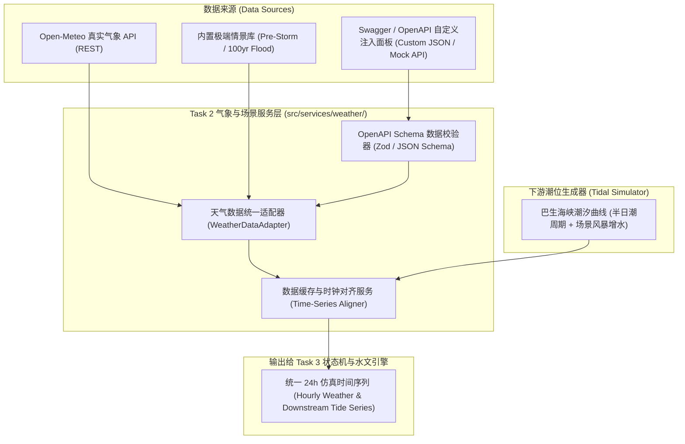

# Task 2 详细实施方案：气象 API 集成、Swagger/OpenAPI 规范与自定义数据注入器

本文档定义了 **Bandar Bukit Raja (BBR) 智慧防洪与湿地管理数字孪生原型** 的 **Task 2** 详细执行规范、模块架构、Open-Meteo 真实气象服务集成、企业级 OpenAPI (Swagger) 规范定义以及多源自定义场景注入系统的设计与验收标准（Checkpoint 2）。

---

## 1. 目标与用户需求改进 (Objective & Enhancements)

根据实际防洪系统验证需求，真实世界中极端暴雨是偶发事件，若仅依赖实时天气 API，日常可能长时间处于无雨或微雨状态，无法有效测试和演示系统的防洪削峰与水闸联锁性能。

因此，Task 2 在接入真实气象数据的基础上，引入**企业级多源数据提供器架构（Multi-Source Weather Provider）**与**类 Swagger/OpenAPI 交互式数据注入控制台**：

1. **真实气象服务集成 (`OpenMeteoProvider`)**：
   - 对接 Open-Meteo 官方 REST API，拉取 BBR 坐标（`3.0850 N, 101.4450 E`）的未来 24~72 小时降雨强度（`precipitation` mm/h）、降雨概率与浅层土壤湿度（`soil_moisture_0_to_7cm`）。
   - 具备缓存、超时回退与网络容错机制。
2. **OpenAPI 3.0 规范定义 (`openapi.json` / `openapi.yaml`)**：
   - 依据企业级 REST 标准，编写完整的气象预报数据摄取、潮汐遥测及场景注入数据契约（Schema Contract）。
3. **类 Swagger 交互式数据控制台与自定义输入 (`CustomApiInjector`)**：
   - **自定义参数化生成器**：用户可在前端界面上直接配置降雨峰值（如 $80\text{ mm/h}$）、降雨开始时间、降雨历时、土壤初始饱和度以及下游巴生海峡潮位。
   - **自定义 JSON / API 数据导入（Swagger/Postman 风格）**：用户可以直接粘贴符合 OpenAPI 规范的自定义 JSON 数据，或指定第三方 Mock API URL 进行数据接入。
4. **预设典型极端灾害场景库 (`PresetScenarios`)**：
   - `SCENARIO_CLEAR_DAY`：常态晴朗无雨。
   - `SCENARIO_PRE_STORM`：当前晴朗，4 小时后遭遇 $80\text{ mm/h}$ 短时强降雨（验证预泄洪）。
   - `SCENARIO_FLASH_FLOOD_HIGH_TIDE`：$100\text{ mm/h}$ 百年一遇暴雨 + 巴生海峡 $2.8\text{ m}$ 大潮倒灌威胁（验证防倒灌联锁熔断与滞洪削峰）。
5. **自动化验证套件 (`scripts/verify-task2.ts`)**：
   - 测试真实 API 解析、预设场景切换、自定义 JSON 校验注入及边界异常处理。

---

## 2. 架构设计与数据流 (Architecture & Data Flow)

采用**策略模式（Strategy Pattern）**与**适配器模式（Adapter Pattern）**，将所有气象与下游潮位数据源统一抽象为 `WeatherDataProvider` 接口：



---

## 3. 详细模块设计与目录规范

在现有工程基础上新增以下文件：

```text
src/
├── services/
│   ├── weather/
│   │   ├── weatherTypes.ts            # 气象时序强类型与 OpenAPI DTO
│   │   ├── openMeteoClient.ts         # Open-Meteo REST API 客户端
│   │   ├── tidalSimulator.ts          # 巴生海峡潮位时序发生器
│   │   ├── presetScenarios.ts         # 预设极端场景定义 (Clear, Pre-Storm, Flash-Flood)
│   │   ├── weatherAdapter.ts          # 统一数据提供器与协调器
│   │   └── openApiSpec.ts             # OpenAPI 3.0 Specification 结构化文档
├── scripts/
│   └── verify-task2.ts                # Task 2 自动化测试与 Checkpoint 2 验证
```

### 3.1 核心数据结构 (`src/services/weather/weatherTypes.ts`)

```typescript
export interface HourlyWeatherPoint {
  /** 格式化时间戳 (ISO 8601 或相对仿真小时 t=0..23) */
  timeIso: string;
  hourOffset: number;
  /** 降雨强度 (mm/h) */
  precipitationMmPerHr: number;
  /** 土壤表层湿度饱和度 (0.0 - 1.0) */
  soilSaturation: number;
  /** 下游外河/海潮预测潮位 (m) */
  downstreamLevelM: number;
  /** 气温 (°C) 与天气简况说明 */
  temperatureC?: number;
  weatherDescription?: string;
}

export interface WeatherScenarioPayload {
  scenarioId: string;
  scenarioName: string;
  sourceType: 'LIVE_API' | 'PRESET' | 'CUSTOM_SWAGGER';
  createdAt: string;
  hourlySeries: HourlyWeatherPoint[];
}
```

### 3.2 预设情景详细数值规格

| 场景代码 | 场景名称 | 降雨特征 | 下游海潮特征 | 预期系统响应 |
| :--- | :--- | :--- | :--- | :--- |
| `LIVE_API` | BBR 实时天气 | 调用 Open-Meteo 实时 API 动态计算 | 正常半日潮（$1.0\text{m} \sim 1.8\text{m}$） | 常态监测维护 |
| `SCENARIO_CLEAR_DAY` | 常态晴天模式 | 24 小时降雨恒为 $0\text{ mm/h}$ | 正常天文潮（$1.2\text{m} \sim 1.6\text{m}$） | 维持 $2.0\text{ m}$ 生态常态水位 |
| `SCENARIO_PRE_STORM` | 强暴雨预警场景 | 前 3 小时晴天（0mm/h），第 4~7 小时爆发 $80\text{ mm/h}$ 特大暴雨，之后降为小雨 | 下游正常平潮（$1.3\text{m} \sim 1.5\text{m}$） | 前 3 小时触发**主动预泄洪**降至 $1.0\text{ m}$；暴雨期触发**削峰滞洪** |
| `SCENARIO_FLASH_FLOOD_HIGH_TIDE` | 极端暴雨 + 海峡天文大潮 | 持续 $100\text{ mm/h}$ 极端降雨，持续 5 小时 | 巴生海峡风暴潮涌，$H_{down}$ 飙升至 $2.8\text{ m} > 2.5\text{ m}$ | **下游联锁立即生效**，严禁开闸，全量滞洪 |

### 3.3 Swagger / OpenAPI 规范与自定义数据注入支持

为满足用户“像 Swagger 一样自己注入数据”的需求，设计两套输入模式：

1. **模式 A：OpenAPI JSON 结构化数据直投（Raw JSON Injection）**：
   - 用户提供符合 `WeatherScenarioPayload` 契约的标准 JSON 数组。
   - 内置校验器对数组长度、数值范围（降雨 $\ge 0$、土壤湿度 $\in [0, 1]$、下游水位）进行严格类型断言，错误时提供友好语法报错提示。
2. **模式 B：图形化交互表单注入（Visual Scenario Builder）**：
   - 界面提供快捷滑块与参数输入（暴雨起始时间、峰值雨量、持续时长、下游高潮高度），一键合成标准时序数据集。

---

## 4. 详细执行步骤 (Execution Sequence)

1. **步骤 1：定义气象与情景强类型系统 (`weatherTypes.ts`)**
   - 规范输入输出契约，包括时序结构、情景元数据、OpenAPI Schema 校验规则。
2. **步骤 2：实现真实 Open-Meteo API 客户端 (`openMeteoClient.ts`)**
   - 调用 `https://api.open-meteo.com/v1/forecast`，传入 BBR 经纬度，解析降雨与土壤湿度。
   - 增加网络离线时的安全降级兜底数据。
3. **步骤 3：实现潮位发生器与预设情景库 (`tidalSimulator.ts` & `presetScenarios.ts`)**
   - 实现巴生海峡潮位半日潮周期（Sine 波形模拟）与极端高潮位情景。
   - 固化三大预设基准情景。
4. **步骤 4：实现统一数据适配器与 Swagger 自定义注入器 (`weatherAdapter.ts`)**
   - 提供 `loadLiveWeather()`、`loadPresetScenario(id)`、`injectCustomScenario(jsonPayload)` 统一出口。
   - 输出 OpenAPI 3.0 规范对象，供后续前端 Swagger 风格控制台直接复用。
5. **步骤 5：编写自动化验证套件 (`scripts/verify-task2.ts`) 并执行 Checkpoint 2 验收**
   - 验证联网请求拉取、预设场景数据生成、自定义 Swagger JSON 注入校验、边界异常拦截。

---

## 5. Checkpoint 2 验收标准与验证方案

在 Task 2 完成时，执行 `npm run verify:task2`（配置到 `package.json`），必须达成以下检查点：

| 校验项 | 测试目标与方法 | 验收断言 |
| :--- | :--- | :--- |
| **真实 API 连通性** | 调用 Open-Meteo 拉取真实 BBR 气象数据 | 成功解析未来 24 小时降雨与土壤湿度数据，数组长度 $\ge 24$ |
| **预设暴雨场景时序** | 加载 `SCENARIO_PRE_STORM` | 验证第 4 小时降雨跃升至 $80\text{ mm/h}$，总暴雨入水量计算正确 |
| **高潮位联锁场景时序** | 加载 `SCENARIO_FLASH_FLOOD_HIGH_TIDE` | 验证下游潮位峰值达到 $2.8\text{ m}$，触发下游超标判据 |
| **自定义 Swagger 数据注入** | 传入用户自定义 JSON 数组 | 校验通过并能无缝切换为当前仿真驱动时序 |
| **非法数据拦截 (Fail-Safe)** | 传入负降雨量或格式破损的自定义 JSON | 校验器正确拦截并抛出明确错误诊断，不污染运行系统 |

---

## 6. 产出交付物

- [weatherTypes.ts](file:///C:/Users/Tan%20Zhi%20Wei/Desktop/Sime%20Darby/src/services/weather/weatherTypes.ts)
- [openMeteoClient.ts](file:///C:/Users/Tan%20Zhi%20Wei/Desktop/Sime%20Darby/src/services/weather/openMeteoClient.ts)
- [tidalSimulator.ts](file:///C:/Users/Tan%20Zhi%20Wei/Desktop/Sime%20Darby/src/services/weather/tidalSimulator.ts)
- [presetScenarios.ts](file:///C:/Users/Tan%20Zhi%20Wei/Desktop/Sime%20Darby/src/services/weather/presetScenarios.ts)
- [weatherAdapter.ts](file:///C:/Users/Tan%20Zhi%20Wei/Desktop/Sime%20Darby/src/services/weather/weatherAdapter.ts)
- [verify-task2.ts](file:///C:/Users/Tan%20Zhi%20Wei/Desktop/Sime%20Darby/scripts/verify-task2.ts)
