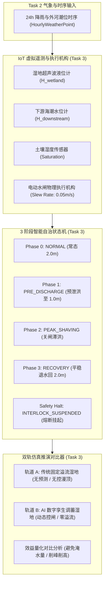

# Task 3 详细实施方案：虚拟 IoT 传感器模拟、3 阶段智能状态机与双轨仿真对比引擎

本文档定义了 **Bandar Bukit Raja (BBR) 智慧防洪与湿地管理数字孪生原型** 的 **Task 3** 详细执行规范、模块架构、虚拟物联网传感器遥测层、带绝对安全联锁的 3 阶段智能控制状态机、以及“传统固定溢流湿地 vs AI 智能湿地”双轨对比推演引擎的设计与验收标准（Checkpoint 3）。

---

## 1. 目标与范围 (Objective & Scope)

在 Task 1（水文计算与安全联锁底层）和 Task 2（天气 API 与多源场景注入）的基础上，Task 3 将构建防洪调蓄系统的**核心自治决策与仿真推演大脑**：

1. **虚拟 IoT 传感器与执行器层 (`src/services/iot/sensorSimulator.ts`)**：
   - 模拟实际布设在 BBR 现场的物理设备：湿地超声波液位计 ($H_{wetland}$)、下游潮位计 ($H_{downstream}$)、土壤湿度传感器 ($S$)。
   - 模拟电动机械水闸执行机构的物理机械行程（含电机回转速度/Slew Rate，避免闸门瞬移，真实呈现升降过程）。
   - 遥测信号采样、物理抖动与心跳健康状态监控。
2. **3 阶段智能自主控制状态机 (`src/core/stateMachine.ts`)**：
   - 严格实现 4 种主要运行模态：`NORMAL`（常态）、`PRE_DISCHARGE`（预泄洪）、`PEAK_SHAVING`（削峰滞洪）、`RECOVERY`（洪后退水）。
   - **绝对下游联锁的全局嵌入**：无论处于预泄洪还是洪后退水阶段，必须前置校验下游安全水头与承载力；排水中途下游超标立即熔断挂起（进入 `INTERLOCK_SUSPENDED` 保护态）。
3. **双轨对比推演引擎 (`src/core/dualTrackSimulator.ts`)**：
   - **轨道 A（传统静态无控湿地 - Static Traditional Wetland）**：固定溢流堰标高 $2.0\text{ m}$，暴雨来临前无预排能力，洪峰来袭直接漫顶溢流超标 ($> 3.5\text{ m}$)，造成城市内涝。
   - **轨道 B（AI 智能动态调蓄湿地 - Smart Twin Wetland）**：前瞻预判暴雨，主动预排腾出超 $50$ 万立方米库容，强降雨期关闸削峰蓄水，雨后受控平稳退水，确保全程低于 $3.5\text{ m}$ 警戒红线。
   - 实时量化输出：**避免溢流水量（$\text{m}^3$）**、**洪峰削减率（%）**与**防洪安全裕度**。
4. **自动化验证套件 (`scripts/verify-task3.ts`)**：
   - 执行 Checkpoint 3 验收断言：对 `SCENARIO_PRE_STORM` 进行 12~24 小时加速仿真，证明智能状态机顺利完成全流程闭环，且水文指标显著优于传统静态湿地。

---

## 2. 架构设计与状态机模型 (Architecture & State Machine)

### 2.1 模块分层与调用关系



### 2.2 状态机转移矩阵与判定逻辑

| 状态 (State) | 进入条件 (Entry Trigger) | 闸门目标开度 | 目标与行为描述 |
| :--- | :--- | :--- | :--- |
| **`NORMAL`** | 6h 预报雨量 $< 10\text{ mm}$ 且 $H \approx 2.0\text{ m}$ | `0.0 m`（微闭） | 维持 $2.0\text{ m}$ 生态常态水深，支持社区景观休闲与微气候调节。 |
| **`PRE_DISCHARGE`** | 6h 累计降雨 $> 30\text{ mm}$ 或预期入水量 $V_{in} > V_{avail}$ | `2.0 m`（全开）*(受联锁制约)* | 在暴雨到来前排空至 $1.0\text{ m}$，创造 $+505,857\text{ m}^3$ 缓冲防洪库容。<br>**联锁守卫**：若下游潮位 $\ge 2.5\text{ m}$ 或水头不满足，拒绝开闸。 |
| **`PEAK_SHAVING`** | 暴雨爆发 ($i > 20\text{ mm/h}$) 或下游外河处于高位 ($H_{down} \ge 2.5\text{ m}$) | `0.0 m`（完全关闭） | 就地拦截暴雨洪水，锁闭水闸，禁止下泄，避免给巴生下游市区管网增加洪涝压力。 |
| **`RECOVERY`** | 降雨衰减 ($i < 2\text{ mm/h}$) 且湿地水位 $H > 2.0\text{ m}$ | `1.0 ~ 1.5 m`（受控开闸） | 暴雨过后下游河道退水，安全有序放水，直至湿地水位回落至 $2.0\text{ m}$ 基准线。 |
| **`INTERLOCK_SUSPENDED`** | 排水期间下游水位突破 $2.5\text{ m}$ 或压差 $< 0.1\text{ m}$ | **强制归零 `0.0 m`** | **秒级急停**：立即关闭闸门以防倒灌或加重下游灾情，进入迟滞闭锁，待下游完全退水后解除。 |

---

## 3. 详细模块设计与目录规范

```text
src/
├── core/
│   ├── stateMachine.ts        # 3 阶段智能控制状态机与转移逻辑
│   ├── simulationClock.ts     # 离散仿真步长时钟推进器 (dt 步进与加速)
│   └── dualTrackSimulator.ts  # 双轨推演对比引擎 (传统固定溢流 vs AI 智能)
├── services/
│   └── iot/
│       └── sensorSimulator.ts # 虚拟 IoT 传感器遥测与闸门机械执行机构
scripts/
└── verify-task3.ts            # Checkpoint 3 自动化测试与 12h 双轨对比验证
```

### 3.1 虚拟 IoT 与执行器设计 (`src/services/iot/sensorSimulator.ts`)

- **超声波液位计模型**：读取当前物理真实水位，叠加高斯白噪声（$\sigma = 0.005\text{ m}$），输出实时遥测读数。
- **闸门执行机构动力学模型**：
  - 电机最大行程速率：$v_{gate} = 0.05\text{ m/s}$（闸门从全闭升至 2.0m 全开需 40 秒物理时间）。
  - 给定时间步长 $\Delta t$，实际开度按最大机械速率追随目标开度：
    $$O_{actual}(t + \Delta t) = O_{actual}(t) + \text{clamp}\left(O_{target} - O_{actual}(t), -v_{gate}\Delta t, v_{gate}\Delta t\right)$$

### 3.2 双轨推演对比算法 (`src/core/dualTrackSimulator.ts`)

在相同的天气时序（如 `SCENARIO_PRE_STORM`）驱动下，同时推进两个虚拟水文沙盘：

#### 轨道 1：传统固定溢流湿地 (Traditional Baseline)
- 起始水位：常态 $2.0\text{ m}$。
- 出流设施：固定的平顶溢流堰（宽 $10\text{ m}$，堰顶标高 $2.0\text{ m}$）。
- 出流遵循堰流公式：若 $H \le 2.0\text{ m}$ 则 $Q = 0$；若 $H > 2.0\text{ m}$ 则 $Q = C_w \cdot W \cdot (H - 2.0)^{1.5}$。
- **缺陷**：暴雨来临前无法提前腾空库容，当暴雨入流达 $48\sim 70\text{ m}^3/\text{s}$ 时，出流不及，水位迅速爬升并击穿 $3.5\text{ m}$ 警戒溢流线，造成周边道路漫水受灾。

#### 轨道 2：AI 智能动态调蓄湿地 (Smart Twin)
- 起始水位：常态 $2.0\text{ m}$。
- 暴雨前 4 小时：通过 Open-Meteo 预报探知暴雨入流量巨大，状态机切入 `PRE_DISCHARGE`，开闸将湿地提前排至 $1.0\text{ m}$ 生态底线。
- 暴雨来临时：状态机切入 `PEAK_SHAVING`，水闸关至 $0\text{ m}$，充分利用腾出的 $50$ 多万方深层库容滞纳全部洪峰。
- 峰值水位：被有效压制在 $2.8\sim 3.1\text{ m}$ 之间（远低于 $3.5\text{ m}$ 溢流红线）。
- 暴雨过后：安全退水回 $2.0\text{ m}$。

---

## 4. 详细执行步骤 (Execution Sequence)

1. **步骤 1：编写虚拟 IoT 遥测与执行机构模型 (`sensorSimulator.ts`)**
   - 实现传感器读数发生器、物理噪点注入以及闸门电机 Slew Rate 平滑升降动力学。
2. **步骤 2：编写 3 阶段智能状态机 (`stateMachine.ts`)**
   - 编写状态流转逻辑，封装开闸前下游准入判定及排水中瞬时熔断保护。
3. **步骤 3：编写离散仿真推进时钟 (`simulationClock.ts`)**
   - 支持高精度固定步长推进（如 $\Delta t = 60\text{s}$），记录完整的逐分/逐小时时序帧。
4. **步骤 4：编写双轨推演对比引擎 (`dualTrackSimulator.ts`)**
   - 实现传统溢流湿地与智能调蓄湿地的并行演算，并输出效益统计数据结构。
5. **步骤 5：编写 Checkpoint 3 自动化验收测试套件 (`scripts/verify-task3.ts`)**
   - 运行 12 小时加速仿真，断言状态机行为并在终端输出详细的双轨对比报表。

---

## 5. Checkpoint 3 验收标准与验证方案

在 Task 3 完成时，通过 `npm run verify:task3` 执行全自动化验收测试，必须满足以下硬性指标：

| 校验项 | 测试目标与输入 | 验收断言 |
| :--- | :--- | :--- |
| **状态机预泄洪触发** | 在 `SCENARIO_PRE_STORM` 晴天前夕（t = 0..3h） | 状态机自动识别暴雨预警并切入 `PRE_DISCHARGE`，湿地水位在暴雨前降至 $1.0\text{ m} \pm 0.05\text{ m}$ |
| **状态机削峰滞洪闭合** | 暴雨在 t = 4h 爆发（雨强 $80\text{ mm/h}$） | 状态机秒级切换至 `PEAK_SHAVING`，水闸目标开度归零 ($0.0\text{ m}$) |
| **下游联锁瞬时阻断** | 注入下游外河高潮位（$H_{down} \ge 2.5\text{ m}$） | 状态机立即熔断进入 `INTERLOCK_SUSPENDED`，严禁下泄 |
| **双轨防洪效益对比** | 运行 12 小时 `SCENARIO_PRE_STORM` 完整推演 | • **传统湿地**：水位突破 $3.5\text{ m}$ 临界线，产生严重溢流内涝。<br>• **AI 智能湿地**：全程最高水位 $\le 3.2\text{ m}$（零溢流，成功避免数十万立方米城市洪涝）。 |

---

## 6. 产出交付物

- [sensorSimulator.ts](file:///C:/Users/Tan%20Zhi%20Wei/Desktop/Sime%20Darby/src/services/iot/sensorSimulator.ts)
- [stateMachine.ts](file:///C:/Users/Tan%20Zhi%20Wei/Desktop/Sime%20Darby/src/core/stateMachine.ts)
- [simulationClock.ts](file:///C:/Users/Tan%20Zhi%20Wei/Desktop/Sime%20Darby/src/core/simulationClock.ts)
- [dualTrackSimulator.ts](file:///C:/Users/Tan%20Zhi%20Wei/Desktop/Sime%20Darby/src/core/dualTrackSimulator.ts)
- [verify-task3.ts](file:///C:/Users/Tan%20Zhi%20Wei/Desktop/Sime%20Darby/scripts/verify-task3.ts)
